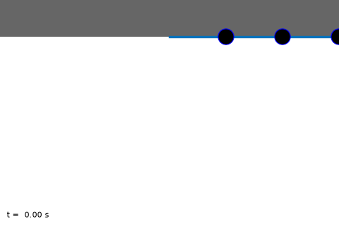
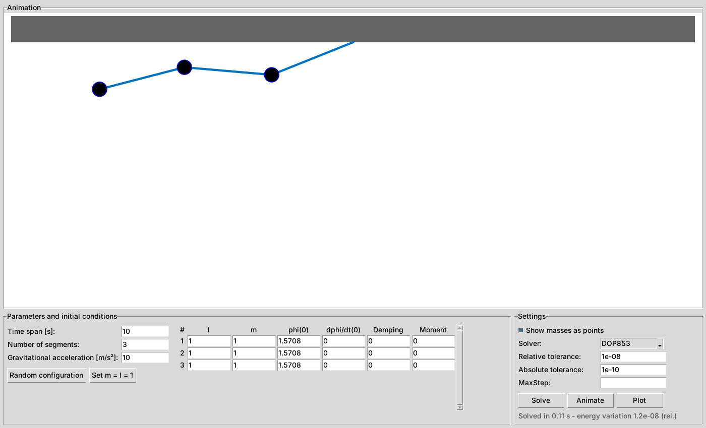

# Triple Pendulum Simulation (n-link pendulum)


Simulation and real-time animation of a planar **n-link pendulum** (e.g. a chaotic triple pendulum) in Python.
The equations of motion are derived with the **Euler-Lagrange formalism** and integrated numerically with SciPy.
A tkinter GUI lets you edit masses, lengths, initial conditions, damping and external moments, run the simulation, animate it and plot energy and angles.

This is a Python port of an earlier MATLAB project (`multipend.m`, `multipendanimation.m`, `multipendgui.m`).

<p align="center">
  
</p>



New to the topic? [`docs/CODE_WALKTHROUGH.md`](docs/CODE_WALKTHROUGH.md) explains the physics and the code step by step.

## Features

- Arbitrary number of segments `n` with individual masses, lengths, damping and external moments
- Equations of motion in matrix form, solved with `scipy.integrate.solve_ivp` (DOP853, RK45, RK23, LSODA, Radau, BDF)
- Kinetic, potential and total energy for checking the numerical accuracy
- Real-time animation and plots of energy and angles
- Random configurations for exploring chaotic behaviour
- Unit tests that check the physics (energy conservation, small-angle period, equilibrium, comparison with a textbook double pendulum)

## Physics

The pendulum consists of point masses $m_i$ connected by massless rigid rods of length $l_i$.
The angles $\varphi_i$ are measured from the downward vertical. The mass at joint $k$ is at

$$x_k = \sum_{j \le k} l_j \sin\varphi_j, \qquad y_k = -\sum_{j \le k} l_j \cos\varphi_j .$$

With $\mu_i = \sum_{k \ge i} m_k$ (sum of all masses from joint $i$ to the free end), the Euler-Lagrange equations (each divided by $l_i$) read

$$\sum_{j=1}^{n} \mu_{\max(i,j)}\, l_j \cos(\varphi_j - \varphi_i)\, \ddot\varphi_j
= \sum_{j=1}^{n} \mu_{\max(i,j)}\, l_j \sin(\varphi_j - \varphi_i)\, \dot\varphi_j^2
- g\,\mu_i \sin\varphi_i - K_i \dot\varphi_i + M_i ,$$

i.e. $A(\varphi)\,\ddot\varphi = b(\varphi, \dot\varphi)$, which is solved for $\ddot\varphi$ in every time step.
$K_i$ is a damping factor and $M_i$ a constant external moment (both enter the equation scaled by $1/l_i$, as in the original MATLAB code).

## Installation

```bash
git clone https://github.com/noahli472-ai/triple-pendulum.git
cd triple-pendulum
python -m venv .venv
source .venv/bin/activate        # Windows: .venv\Scripts\activate
pip install -r requirements.txt
```

tkinter ships with the official Python installers for Windows and macOS. On Linux you may need `sudo apt install python3-tk`.

Step-by-step guide for VS Code on Windows, including fixes for common errors: [`docs/RUNNING_IN_VSCODE.md`](docs/RUNNING_IN_VSCODE.md).

## Usage

**GUI**

```bash
python -m multipendulum
```

Enter parameters (confirm with Enter), click **Solve**, then **Animate** or **Plot**.

**Script without GUI**

```bash
python examples/triple_pendulum.py                  # plots + animation
python examples/triple_pendulum.py --save demo.gif  # export a GIF
```

**As a library**

```python
import numpy as np
from multipendulum import simulate

res = simulate(
    t_span=(0, 10),
    m=[1, 1, 1],  # masses [kg]
    l=[1, 1, 1],  # lengths [m]
    phi0=[np.pi / 2] * 3,  # initial angles [rad]
    g=9.81,
)
print(res.t.shape, res.phi.shape)  # time vector, angles (N x n)
print(abs(res.E - res.E[0]).max())  # energy error
```

## Tests and code quality

```bash
pip install pytest ruff
pytest                 # physics tests (energy conservation, analytic period, ...)
ruff check .           # linting
ruff format --check .  # formatting
```

GitHub Actions runs all three on every push (`.github/workflows/ci.yml`).

## Project structure

```
triple-pendulum/
├── multipendulum/
│   ├── dynamics.py      # equations of motion, ODE solution, energies   (multipend.m)
│   ├── animation.py     # drawing and animation with matplotlib         (multipendanimation.m)
│   ├── gui.py           # tkinter GUI                                   (multipendgui.m)
│   ├── presets.py       # random parameter configurations (GUI-independent)
│   └── __main__.py      # python -m multipendulum
├── docs/CODE_WALKTHROUGH.md   # step-by-step explanation of physics and code
├── examples/triple_pendulum.py
├── tests/test_dynamics.py
├── assets/              # GIF and screenshot for this README
├── requirements.txt
└── pyproject.toml
```

## MATLAB → Python

| MATLAB | Python |
|---|---|
| `ode113`, `ode45`, `ode15s`, ... | `solve_ivp` with `DOP853`, `RK45`, `BDF`, ... |
| `odeset('AbsTol', 'MaxStep')` | `rtol`, `atol`, `max_step` |
| `linsolve(A, b)` | `numpy.linalg.solve(A, b)` |
| `bsxfun`, `cumsum` | NumPy broadcasting, `np.cumsum` |
| `figure` / `uicontrol` / `uitable` | tkinter + embedded matplotlib |
| `interp1` + `tic/toc` animation loop | `np.interp` + `Tk.after` loop |

## Credits

- Original MATLAB code: "Multi-Pendulum simulation", © 2016 Tillmann Stübler,
  [MATLAB Central File Exchange](https://www.mathworks.com/matlabcentral/fileexchange/59977-multi-pendulum-simulation)
- Modifications of the MATLAB version: Lucas Zieger, Noah Lindner
- Python port (2026): Noah Lindner

## License

The Python port in `multipendulum/` is a derivative of Tillmann Stübler's code and keeps its
**BSD 2-Clause License**. All other files (tests, examples, documentation, packaging) are released
under the **MIT License**. See [`LICENSE`](LICENSE) for both texts.
